<div align="center">

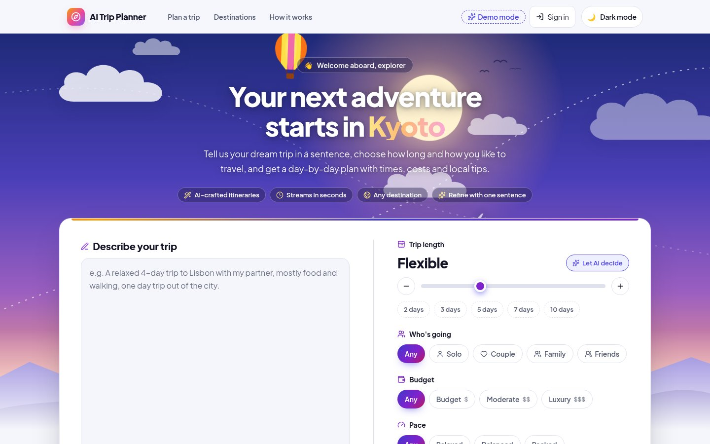

# ✈️ AI Trip Planner

**Describe a trip in plain English. Get a streamed, day-by-day itinerary with times, costs, maps and local tips, validated end to end before it reaches the screen.**

[**🌍 Live demo**](https://YOUR-LIVE-URL-HERE) &nbsp;·&nbsp; [Features](#-features) &nbsp;·&nbsp; [How it works](#-how-it-works) &nbsp;·&nbsp; [Getting started](#-getting-started) &nbsp;·&nbsp; [API](#-api-reference) &nbsp;·&nbsp; [Deploy](#-deploying-to-aws-ec2)

<br>

[](https://react.dev)
[](https://www.typescriptlang.org)
[](https://vitejs.dev)
[](https://expressjs.com)
[](https://zod.dev)
[](https://ai.google.dev)
[](#-testing)

</div>

<br>

## 📖 Overview

AI Trip Planner turns a free-form sentence such as *"A relaxed 5-day trip to Lisbon for two, mostly food and walking"* into a structured itinerary you can read, reorder, edit and refine.

The model's raw text is never shown to the user. Gemini is asked for strict JSON, the Express proxy validates it against a **Zod schema shared with the frontend**, and the browser validates it again before rendering. Anything that doesn't match becomes a clear error state, not a broken page.

<div align="center">
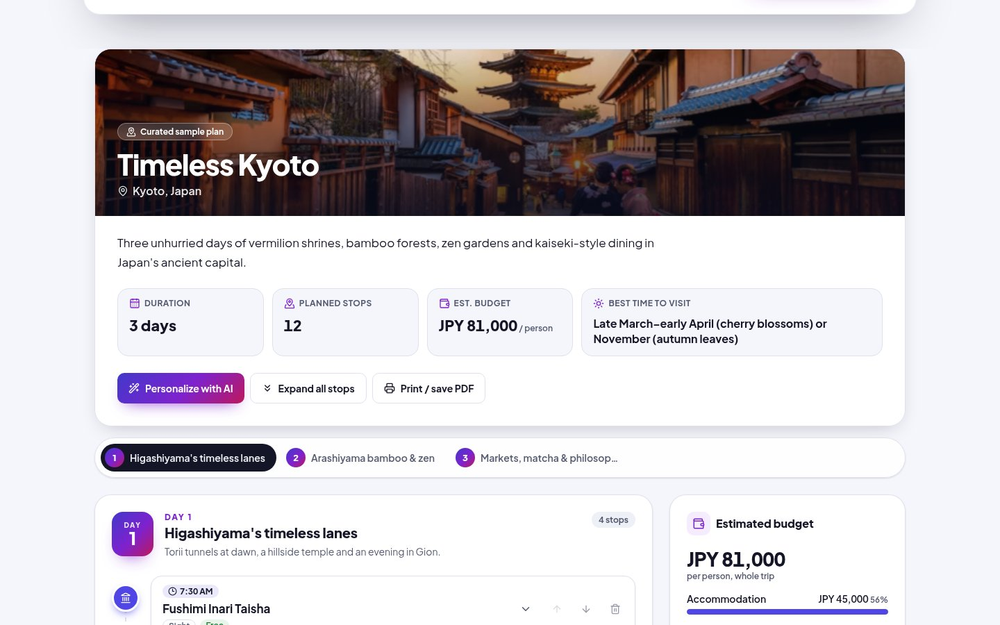
</div>

<br>

## 📑 Table of contents

- [Features](#-features)
- [Screenshots](#-screenshots)
- [How it works](#-how-it-works)
- [Architecture](#-architecture)
- [Tech stack](#-tech-stack)
- [Getting started](#-getting-started)
- [Configuration](#-configuration)
- [API reference](#-api-reference)
- [Project structure](#-project-structure)
- [Testing](#-testing)
- [Deploying to AWS EC2](#-deploying-to-aws-ec2)
- [Security notes and limitations](#-security-notes-and-limitations)
- [Roadmap](#-roadmap)
- [Built with](#-built-with)

<br>

## ✨ Features

### Planning

| | |
|---|---|
| 📝 **Describe it your way** | One textarea (2,000 characters) with example prompts. No rigid multi-field form. |
| 🎛️ **Trip preferences** | Trip length (1 to 14 days, or "Let AI decide"), who's going, budget level, pace and interests. Choices are added to the prompt only when you change them from the defaults. |
| 🗺️ **Featured destinations** | Eight destinations (Kyoto, Paris, Bali, Santorini, New York, Iceland, Marrakech, Rome) with photos, filters and a **curated 3-day sample plan that opens instantly**, with no API call. Each card can also generate a fresh AI plan. |
| 🌊 **Streaming results** | Days appear one by one as Gemini streams them over Server-Sent Events, with a live progress indicator and skeleton cards. |
| 💬 **Refine in one sentence** | Ask for "add a coffee break" or "swap day 2's museum for a park" without regenerating the whole plan. |

### Reading the plan

| | |
|---|---|
| 🧭 **Trip overview** | Title, summary, duration, stop count, estimated budget and best time to visit. |
| 📌 **Sticky day navigation** | Jump between days; the active day follows your scroll. |
| 🕒 **Timeline cards** | Each stop has a category icon, time, price tag and expandable details: description, location with an **Open in Maps** link, and a tip callout. |
| 💰 **Sidebar cards** | Budget breakdown with animated bars, an interactive packing checklist with progress, and local tips. |
| 🧩 **Rich block types** | Cost summaries, checklists and bar charts render with their own cards. Unknown block types fall back to the standard stop view. |

### Editing and polish

| | |
|---|---|
| ↕️ **Editable itinerary** | Expand or collapse stops, remove them, or reorder with move up and move down controls. |
| 💾 **Save and restore** | The last itinerary is saved to `localStorage` and offered back on your next visit. Corrupt or unavailable storage never breaks the app. |
| 🔁 **Stale-request safe** | A request id plus `AbortController` guarantees only the latest request's result is rendered, however fast you resubmit. |
| 🛫 **Travel-themed login** | Animated sign-in and register page with a **Try the demo** option that unlocks everything without an account. |
| 🌗 **Light and dark themes** | Design tokens for both themes, with reduced-motion support. |
| ♿ **Accessible by default** | Keyboard operable, visible focus ring, 44px touch targets, labelled controls and live regions. |
| 📱 **Responsive** | Works from 375px phones to wide desktops. |
| 🖨️ **Print ready** | One click to print or save the itinerary as PDF, with navigation and forms hidden. |

<br>

## 🎨 Screenshots

<table>
<tr>
<td width="50%">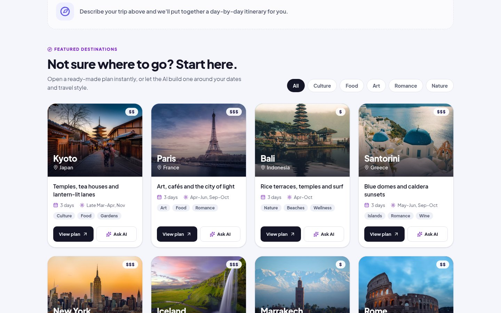<br><sub><b>Featured destinations</b>: tap a card for an instant sample plan</sub></td>
<td width="50%">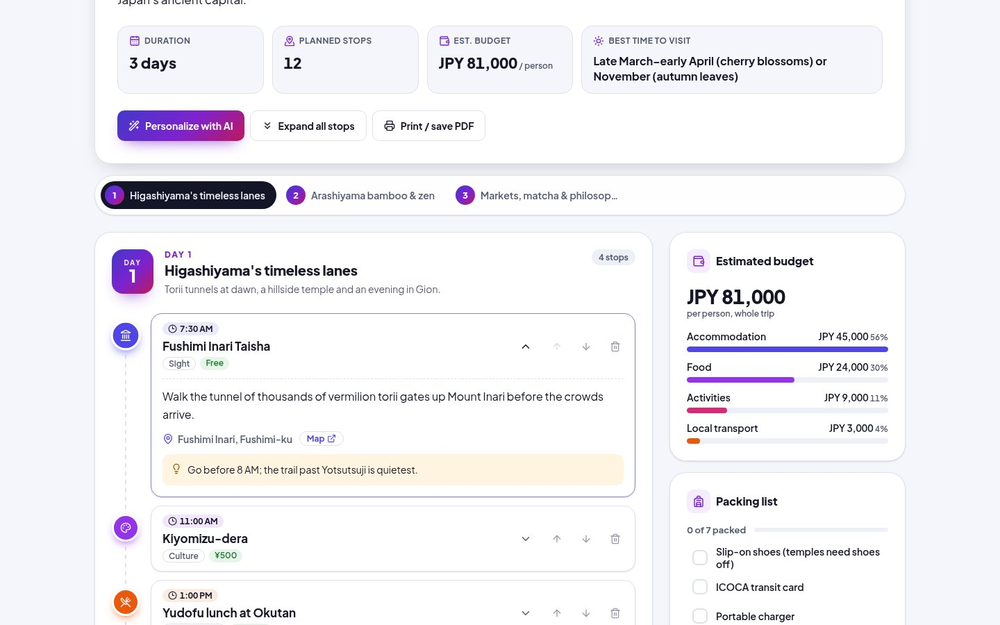<br><sub><b>Stop details</b>: map link, tips, budget and packing list</sub></td>
</tr>
<tr>
<td width="50%">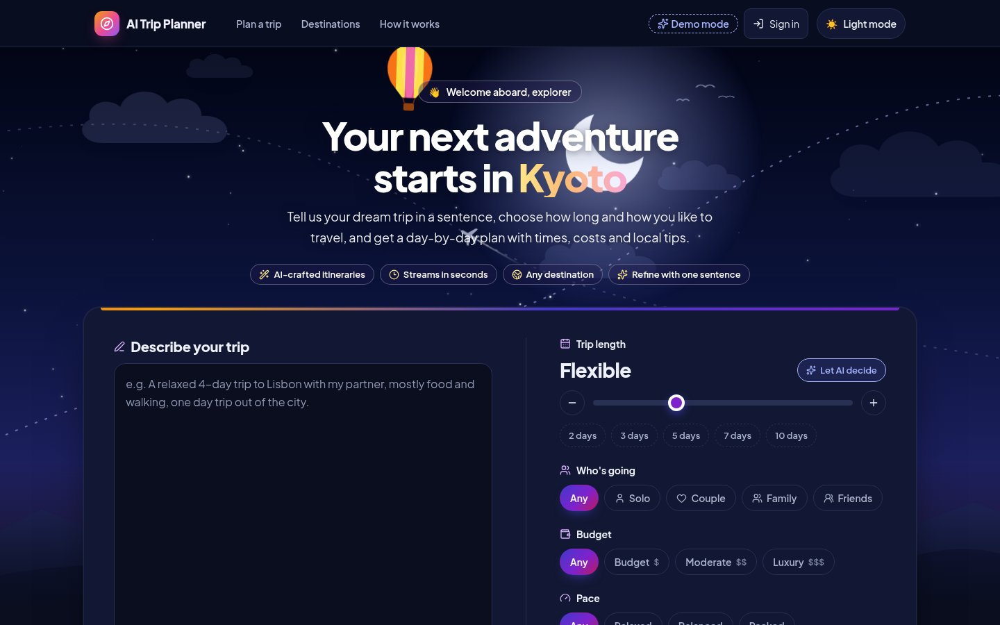<br><sub><b>Dark theme</b></sub></td>
<td width="50%">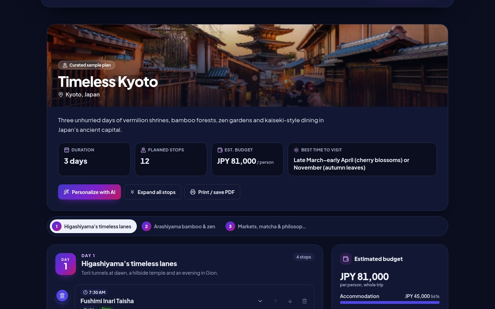<br><sub><b>Dark theme itinerary</b></sub></td>
</tr>
</table>

<div align="center">
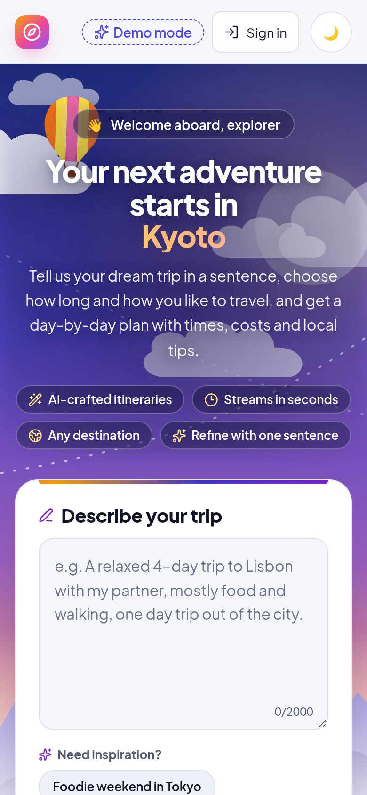
&nbsp;&nbsp;
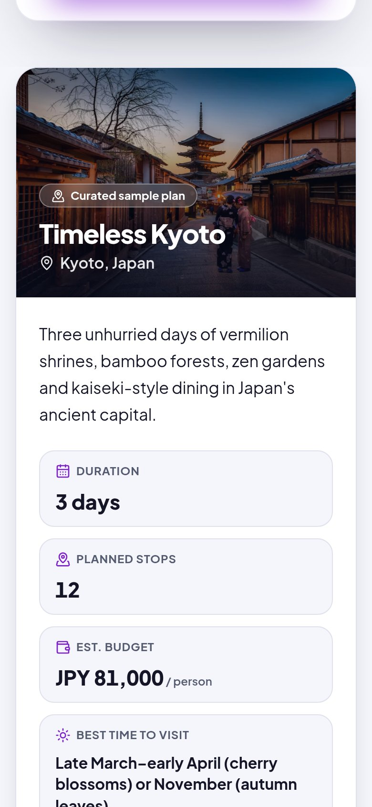
<br><sub><b>Mobile</b></sub>
</div>

<br>

## 🔄 How it works

### 1. The user journey

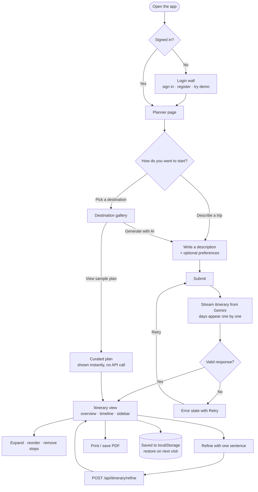

### 2. What happens when you press "Plan my trip"

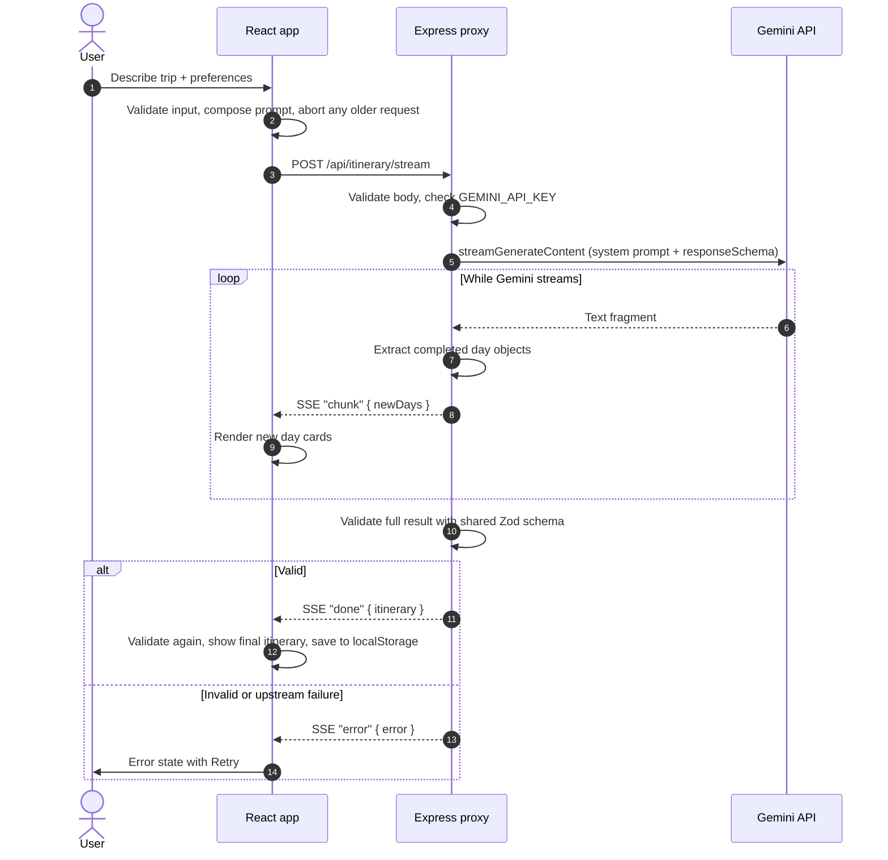

### 3. Request lifecycle in the UI

Every submission moves through the same small state machine, so the screen always shows exactly one state.

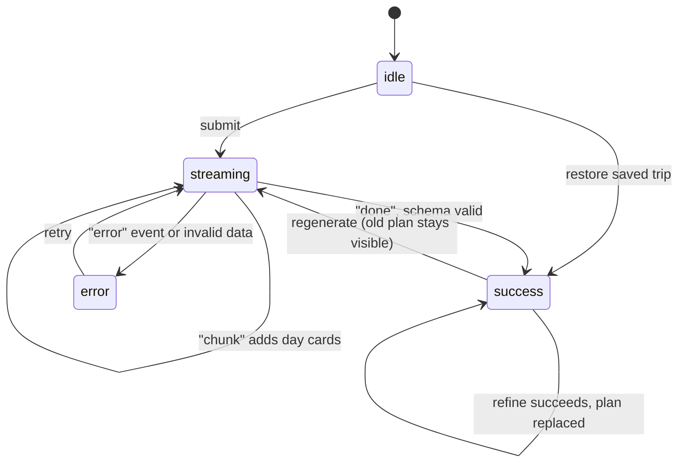

> A newer submission aborts the older request, so a late response can never overwrite the latest one. If a retry, regenerate or refinement fails, the previous itinerary stays on screen with a non-blocking banner, and days that had already streamed in are kept and marked incomplete.

### 4. Authentication flow

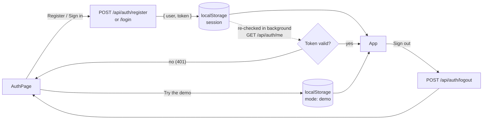

### 5. Data model

The shared schema in `shared/itinerarySchema.ts` is the single source of truth. Core fields are strict. Decorative extras (title, summary, budget, packing list, tips, categories, prices) are optional and **dropped quietly if malformed**, so a small model slip never fails the whole response.

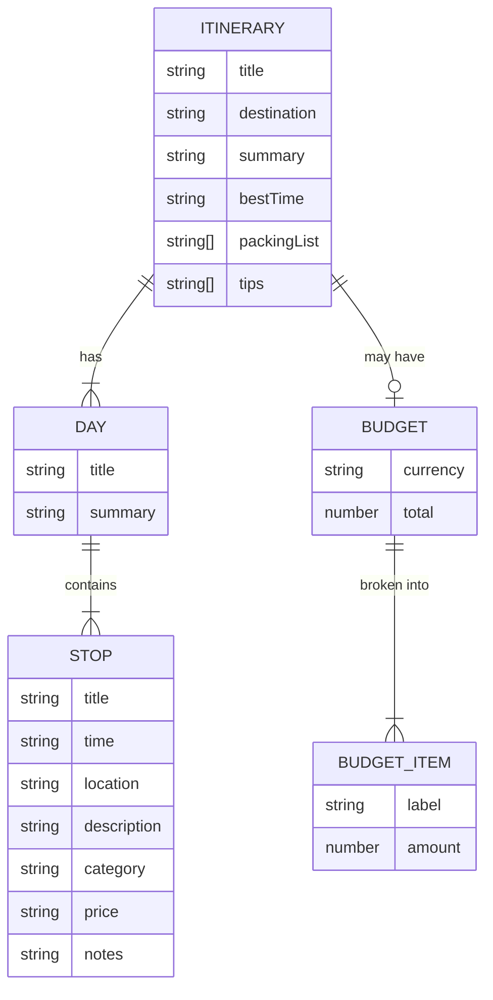

<br>

## 🧱 Architecture

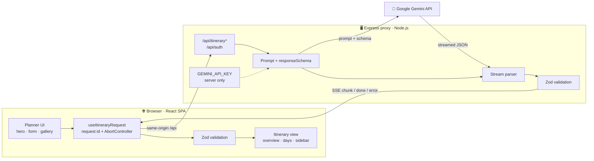

**Why a proxy?** The Gemini key must never reach the browser. It lives only in the server's environment and is never included in a response. The frontend only talks to same-origin `/api` paths, so it has no visibility of Gemini's endpoint or credentials.

**Why validate twice?** The server checks Gemini's output before forwarding it, so an invalid shape can't be disguised as a `200 OK`. The client checks again because it should never trust the network.

<br>

## 🧰 Tech stack

| Layer | Choice | Why |
|---|---|---|
| **Frontend** | React 18, Vite, TypeScript | Fast dev server, strict types, hooks only. No state library needed. |
| **Icons** | lucide-react | Consistent, tree-shakeable icon set. |
| **Styling** | CSS Modules + design tokens | Scoped styles and one `tokens.css` for light and dark themes. |
| **Backend** | Express on Node.js | Small, well known, easy to host anywhere. |
| **AI** | Google Gemini (`gemini-flash-lite-latest`) | JSON mode with `responseSchema` constrains output; a fast model keeps streaming snappy. |
| **Validation** | Zod, shared via the `@shared/*` alias | One schema enforced identically on server and client. |
| **Streaming** | Server-Sent Events | Simple one-way stream, works through standard proxies. |
| **Testing** | Vitest + React Testing Library | Shares Vite's pipeline, fast and ESM native. |
| **Images** | Unsplash | Destination photos, with gradient fallbacks if they fail to load. |

<br>

## 🚀 Getting started

### Prerequisites

| Requirement | Notes |
|---|---|
| **Node.js** 22.9 or newer | The server script uses the native `--env-file-if-exists` flag. |
| **npm** | Ships with Node. |
| **Gemini API key** | Free from [Google AI Studio](https://aistudio.google.com/app/apikey). |

### Run locally

```bash
# 1. Clone and install (one package.json covers frontend and backend)
git clone https://github.com/Exohubb/ai-trip-planner.git
cd ai-trip-planner
npm install

# 2. Add your Gemini key
cp .env.example .env
#    then edit .env and set GEMINI_API_KEY=your-key

# 3. Start the Vite dev server and the Express proxy together
npm start
```

Open **http://localhost:5173**. Use **Try the demo** on the login page to skip account creation.

> No key yet? The demo destinations still work, because the curated sample plans need no API call. Generating a new plan requires the key.

### Scripts

| Command | What it does |
|---|---|
| `npm start` / `npm run dev` | Runs the client (`:5173`) and server (`:3001`) together |
| `npm run client` | Vite dev server only |
| `npm run server` | Express proxy only, with auto-reload |
| `npm test` | Runs the whole test suite once |
| `npm run typecheck` | `tsc --noEmit` across the project |
| `npm run build` | Production build of the frontend into `dist/` |

Vite proxies `/api/*` to the Express server in development, so there is no CORS setup.

<br>

## 🔧 Configuration

| Variable | Required | Default | Description |
|---|---|---|---|
| `GEMINI_API_KEY` | ✅ | none | Your Gemini key. Without it the API returns `server_misconfigured`. |
| `SERVER_PORT` | | `3001` | Port the Express server listens on. |
| `AUTH_DATA_FILE` | | `server/data/users.json` | Where login accounts are stored. |

Put these in `.env`. The file is gitignored, so never commit it. `.env.example` is the committed template and must stay free of real keys.

<br>

## 🔌 API reference

All errors have the shape `{ "error": "<code>" }`.

| Method | Path | Body | Success | Errors |
|---|---|---|---|---|
| `GET` | `/api/health` | none | `200` | none |
| `POST` | `/api/itinerary` | `{ description }` | `200 { itinerary }` | `missing_description`, `description_too_long`, `server_misconfigured`, `upstream_error`, `invalid_response` |
| `POST` | `/api/itinerary/stream` | `{ description }` | `200` SSE: `chunk { newDays }`, `done { itinerary }`, `error { error }` | same codes as above |
| `POST` | `/api/itinerary/refine` | `{ instruction, currentItinerary }` | `200 { itinerary }` | `missing_instruction`, `instruction_too_long`, `invalid_current_itinerary`, `server_misconfigured`, `upstream_error`, `invalid_response` |
| `POST` | `/api/auth/register` | `{ name, email, password }` | `201 { user, token }` | `missing_fields`, `invalid_name`, `invalid_email`, `weak_password`, `email_taken` (409) |
| `POST` | `/api/auth/login` | `{ email, password }` | `200 { user, token }` | `missing_fields`, `invalid_credentials` |
| `GET` | `/api/auth/me` | `Authorization: Bearer <token>` | `200 { user }` | `401 unauthorized` |
| `POST` | `/api/auth/logout` | `Authorization: Bearer <token>` | `204` | none |

**Quick test**

```bash
curl -N -X POST http://localhost:3001/api/itinerary/stream \
  -H "Content-Type: application/json" \
  -d '{"description":"A relaxed 3-day trip to Lisbon for two, mostly food and walking"}'
```

<br>

## 📂 Project structure

```
ai-trip-planner/
├── docs/screenshots/            # README images
├── shared/
│   └── itinerarySchema.ts       # Zod schema + types, used by server and client
├── server/
│   ├── server.ts                # Express app and itinerary routes (JSON + SSE)
│   ├── authRoutes.ts            # register, login, me, logout
│   ├── userStore.ts             # file-backed accounts and sessions (demo grade)
│   ├── gemini.ts                # callLLM() / streamLLM(): isolated Gemini integration
│   ├── promptBuilder.ts         # system instruction + responseSchema
│   └── streamParser.ts          # pulls completed days out of a streamed response
├── src/
│   ├── main.tsx, Root.tsx       # entry + login wall gate
│   ├── App.tsx                  # planner page: nav, hero, results, gallery, footer
│   ├── data/destinations.ts     # 8 destinations with curated sample itineraries
│   ├── hooks/                   # useItineraryRequest, useStoredItinerary, useAuth, useTheme, ...
│   ├── lib/                     # fetch + validate pipelines, SSE client, tripPreferences, stopCategory
│   ├── components/
│   │   ├── PlannerHero/  TripInputForm/  TripPreferences/
│   │   ├── DestinationGallery/  HowItWorks/
│   │   ├── ResultArea/  TripOverview/  ItineraryView/  DayCard/  StopItem/
│   │   ├── TripSidebar/             # budget, packing list, tips
│   │   ├── CostCard/  ChecklistCard/  ChartCard/
│   │   ├── RefinementForm/  RetryBanner/  RestorePrompt/  StreamingIndicator/
│   │   ├── LoadingSkeleton/  ErrorState/  EmptyState/  EmptyResultState/
│   │   └── AuthPage/  AccountBar/  ThemeToggle/
│   └── styles/tokens.css        # colors, spacing, type, shadows, dark theme
├── vite.config.ts               # dev proxy: /api -> Express
└── .env.example
```

<br>

## 🧪 Testing

| Metric | Result |
|---|---|
| Test files | 31 |
| Tests | 248 passing ✅ |
| Type check | `tsc --noEmit` clean ✅ |

Tests are weighted toward the riskiest area first, the AI response pipeline.

| Area | What's covered |
|---|---|
| **Schema** | Valid and invalid shapes, size limits, malformed optional extras being dropped |
| **Backend** | Request validation, key guard, prompt building, response validation, SSE streaming, refine, auth |
| **Frontend pipeline** | Malformed JSON, non-2xx, network failure, schema-invalid bodies, stream parsing |
| **Request lifecycle** | A late response from an older request is discarded |
| **Components** | Every state (loading, error, empty, populated), editing, retry, restore, preferences, sample plans |

```bash
npm test
npm run typecheck
```

<br>

## 🚢 Deploying to AWS EC2

The Express server only serves `/api`. It does not serve the built frontend, so a single Ubuntu instance runs **nginx** (static files + reverse proxy) in front of **Node**.

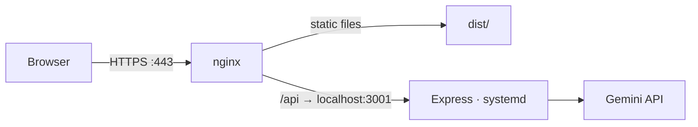

1. **Launch** an Ubuntu LTS `t3.micro` with 16 GiB storage. Security group: SSH (22) from your IP only, HTTP (80) and HTTPS (443) open. **Do not open 3001.**
2. **Attach an Elastic IP** so the address survives restarts.
3. **Install** Node 22+, nginx and git.
4. **Build locally** with `npm run build` (a 1 GB instance can run out of memory building), then upload `dist/`. On the server, run `npm ci --omit=dev` and create `.env` with `GEMINI_API_KEY`.
5. **Run the API** under systemd or pm2 so it restarts on reboot.
6. **Configure nginx**:

```nginx
server {
    listen 80;
    server_name your-domain.example;

    root /var/www/ai-trip-planner/dist;
    index index.html;

    location / {
        try_files $uri /index.html;
    }

    location /api/ {
        proxy_pass http://127.0.0.1:3001;
        proxy_http_version 1.1;
        proxy_set_header Host $host;
        proxy_set_header X-Real-IP $remote_addr;
    }

    # Streaming must not be buffered, or days arrive all at once at the end
    location /api/itinerary/stream {
        proxy_pass http://127.0.0.1:3001;
        proxy_http_version 1.1;
        proxy_buffering off;
        proxy_cache off;
        proxy_read_timeout 120s;
    }
}
```

7. **HTTPS**: point your domain at the Elastic IP and run `sudo certbot --nginx`.

<br>

## 🔐 Security notes and limitations

Read this before deploying publicly.

- **The login wall is demo grade.** Accounts live in a local JSON file (`server/data/users.json`, gitignored) with **plain-text passwords**, no hashing, no token expiry and no rate limiting. Don't use a real password, and hash passwords (for example with `argon2` or `bcrypt`) before real use.
- **The itinerary endpoints don't require a session.** Anyone who can reach the server can spend your Gemini quota. Add authentication and rate limiting on `/api/itinerary*` before exposing it.
- **The Gemini key stays server side.** It is read from the environment per request and never returned to the client.
- **Single provider.** Only Gemini is supported. `server/gemini.ts` pins a model name. If Google retires it you'll see upstream 404s, so check `GET https://generativelanguage.googleapis.com/v1beta/models?key=YOUR_KEY` for current names.
- **AI output can be wrong.** Prices, opening hours and availability in generated plans are suggestions. Verify them before booking. The curated sample plans are illustrative too.
- **Assistive technology.** Keyboard and contrast behaviour are covered by tests and review, but a full screen-reader pass on real devices is still worthwhile.

<br>

## 🧭 Roadmap

- [ ] Hash passwords, add token expiry and rate limiting
- [ ] Require a session for itinerary endpoints
- [ ] Save multiple trips per account, backed by a database
- [ ] Shareable read-only trip links
- [ ] Drag-and-drop stop reordering
- [ ] Map view of each day's stops
- [ ] Docker image and one-command deploy

<br>

## 🔨 Built with

Built with [Kiro](https://kiro.dev), working from a spec (`.kiro/specs/ai-trip-planner`) and delivered in small, tested increments. Destination photos are from [Unsplash](https://unsplash.com). Icons by [Lucide](https://lucide.dev).

<br>

<div align="center">

**[⬆ Back to top](#)**

</div>
